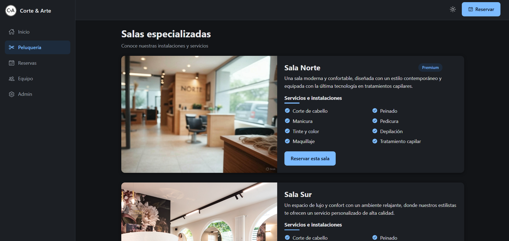
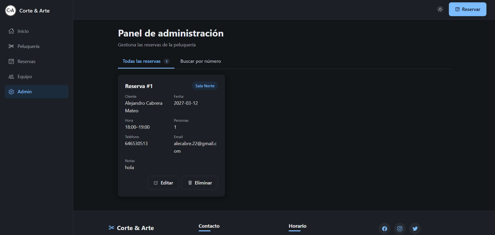
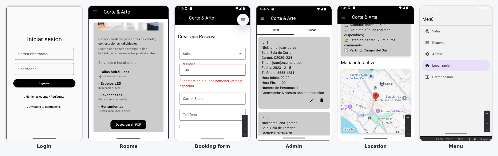

# Corte & Arte

Booking system for a hair salon, made of three parts that work together:

- **Android app** in Kotlin with Jetpack Compose.
- **Website** in React (Vite + React Router).
- **REST API** in Node.js and Express with MongoDB, shared by both clients.

Customers can browse the salon's rooms and services and book an appointment from the website or the app. From the admin area, bookings can be listed, searched by number, edited and deleted.

### Website (React)





### Android app



## Architecture

```
Android app (Kotlin, Compose, Retrofit) ──┐
                                          ├──▶  REST API (Express)  ──▶  MongoDB Atlas
Website (React, fetch) ───────────────────┘
```

| Method | Endpoint | Description |
|---|---|---|
| GET | `/api/reservas` | List all bookings |
| GET | `/api/reservas/:id` | Get one booking |
| POST | `/api/reservas` | Create a booking |
| PUT | `/api/reservas/:id` | Update a booking |
| PATCH | `/api/reservas/:id` | Update some fields |
| DELETE | `/api/reservas/:id` | Delete a booking |

## Features

**Website (React)**
- Pages for home, rooms, booking, team and admin, with client-side routing.
- Booking form with validation (name, email, phone, date not in the past, end time after start time) and accessible error messages.
- Admin panel with full CRUD against the API, loading and error states, and delete confirmation.
- "Book this room" links pre-select the room in the booking form.
- Light and dark themes (saved preference, otherwise follows the system), responsive layout with a mobile menu, and WCAG-minded contrast and focus styles.

**Android app**
- Login and registration with Firebase Authentication, including password reset.
- Rooms screen built with `LazyColumn`, with export to PDF (`PdfDocument`).
- Booking form with validation, and an admin screen to list, search, edit and delete bookings (MVVM with `ViewModel` + Retrofit).
- Location screen with an interactive Google Map (maps-compose) and navigation drawer.

## Project structure

```
android/   Android app (Kotlin, Jetpack Compose)
api/       REST API (Node.js, Express, Mongoose)
web/       Website (React, Vite)
```

## Running it locally

**1. API**
```bash
cd api
cp .env.example .env      # then add your MongoDB connection string
npm install
npm run dev               # http://localhost:3000
```

**2. Website**
```bash
cd web
cp .env.example .env      # VITE_API_URL=http://localhost:3000/api
npm install
npm run dev               # http://localhost:5173
```

**3. Android app**
Open `android/` in Android Studio. Add your own `google-services.json` (Firebase) in `android/app/` and your Google Maps key in `local.properties` as `MAPS_API_KEY=...`. Neither file is committed. When running on the emulator, the API is reachable at `http://10.0.2.2:3000/api/`.

## Tech stack

React · React Router · Vite · JavaScript · CSS · Kotlin · Jetpack Compose · Retrofit · Firebase Auth · Google Maps · Node.js · Express · MongoDB · Mongoose

## Author

Alejandro Cabrera Mateo · [GitHub](https://github.com/alecabreradev) · [LinkedIn](https://linkedin.com/in/alejandro-cabrera-mateo-6761b030b)
